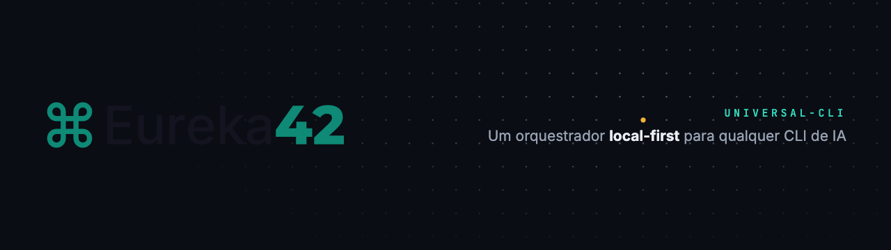

  

<h1 align="center">Do insight ao código.</h1>

  <strong>Eureka42</strong> é um framework e uma comunidade sobre IA — <b>local-first</b>,
  código aberto e sem clichê. Nada de cérebros, robôs ou degradê roxo-azul:
  só engenharia de verdade, demonstrável e documentada.

  <code>Eureka</code> é o instante da descoberta ·
  <code>42</code> é a resposta ·
  <code>⌘</code> é o atalho

---

## Projetos

| Repositório | Descrição |
|---|---|
| [**universal-cli**](https://github.com/eureka42-ai/universal-cli) | Orquestrador desktop local-first (Tauri 2 + Rust + React) para qualquer CLI de IA — terminal PTY real, memória universal, histórico FTS5 e sync cifrado via Google Drive/OneDrive. macOS · Windows · Linux |

## O manifesto em seis linhas

1. **Local-first radical** — seus dados ficam no seu computador; sem servidor, sem telemetria.
2. **Qualquer agente, sem imitação** — executamos as CLIs reais que você instalou, TUI íntegra.
3. **Você é o dono do contexto** — memória universal e handoffs em pacotes verificáveis (UAHP).
4. **Capacidade só com evidência** — o que não foi testado é dito, não prometido.
5. **Sem clichê de IA** — interface escura sobre a grade 42, tipografia séria.
6. **Código aberto** — decisões documentadas, estado real registrado.

## Links

- **Site:** [eureka42.org](https://eureka42.org)
- **Apresentação do manifesto:** [slides](https://github.com/eureka42-ai/universal-cli/blob/main/docs/apresentacao/index.html)
- **Issues e PRs são bem-vindos.**
